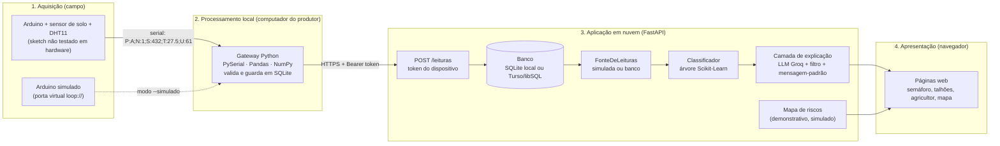

# Arquitetura do AgroAnálise (MVP, C3)

Segue as quatro camadas do relatório (seção 8.1, Quadro 2) e o fluxo operacional da seção 8.2. Tudo o que está
marcado como **simulado** roda sem o Arduino, que ainda não foi montado.

## Camadas e arquivos

| Camada | Onde roda | Arquivos | Responsabilidade |
|---|---|---|---|
| Aquisição | Campo ou bancada | `prototipo/arduino/agroanalise/agroanalise.ino` | Ler solo (bruto 0..1023) e DHT11; enviar uma linha por leitura. **Não testado em hardware; calibração pendente.** |
| Processamento local | Computador ligado ao Arduino | `prototipo/gateway/` | Validar a linha (incompleta, `nan`, sensor solto, faixa, reenvio, oscilação), converter o solo para %, guardar em SQLite local e enviar com retentativa e backoff. |
| Aplicação em nuvem | Função Python na Vercel | `prototipo/app/`, `prototipo/index.py` | Receber leituras autenticadas, guardar, classificar, gerar a mensagem e servir as páginas. |
| Apresentação | Navegador do celular | `prototipo/web/` | Semáforo com palavra, ícone e forma; “Sem dados atualizados” em cinza; visão agricultor e técnico. |

## Decisões de projeto

- **O classificador decide a cor; o LLM só explica.** Entrada do LLM só estruturada (classe, espécie, três
  números); saída filtrada (tamanho, idioma, dose/produto/manejo, coerência com a classe); se algo falhar, vale a
  mensagem-padrão (`app/explicacao.py`). Avaliação em `docs/avaliacao/llm.md`.
- **Uma avaliação só para tudo:** `/classificar`, o simulador e o banco passam pela mesma função (`app/servico.py`).
- **Fonte de leituras trocável** (`FONTE_LEITURAS`): `simulada` (determinística, rápida para demonstrar) ou `banco`
  (leituras do gateway, com a regra de dado desatualizado `MINUTOS_DESATUALIZADO`). As páginas usam só `/status`.
- **Banco remoto opcional com fail-soft:** `TURSO_DATABASE_URL` + `TURSO_AUTH_TOKEN` (ou `DATABASE_URL`) escolhem o
  banco; sem ele, o SQLite local é o padrão. Com a fonte simulada, falha de banco não derruba páginas, `/status`,
  `/classificar` ou `/metricas`; rotas de banco respondem 503. Com a fonte `banco`, falha no startup é fatal para não
  exibir dado velho como atual.
- **Regra conservadora do Vermelho:** peso 3 para o Vermelho no treino, escolhido por validação cruzada só no treino
  (`ml/treinar.py`); revocação do Vermelho 0,922 no teste.
- **Faixas num único arquivo** (`config/faixas.json`): treino, rotulagem provisória, validação e interface.
- **Sem estado no servidor para o simulador:** o navegador pede o “passo”; serve para pausar e acelerar e não
  depende de memória do servidor (que pode reiniciar no plano gratuito).
- **Localização só no navegador** (mapa de riscos): a API recebe o nome da região, nunca a coordenada.

## Riscos de operação e o que foi feito

| Risco | Efeito | Mitigação |
|---|---|---|
| Função serverless | Cold start e nenhuma tarefa em segundo plano | Aviso “O servidor está acordando…” na interface; health check em `/saude`; alimentador desligado quando `VERCEL` existe. |
| Disco efêmero | SQLite apagado num reinício | Turso/libSQL remoto (`TURSO_DATABASE_URL` + `TURSO_AUTH_TOKEN`); semente manual de 72 h **simuladas** (`app/semear.py`). |
| Banco indisponível | Rotas de histórico e disponibilidade falham | Fail-soft com `FONTE_LEITURAS=simulada` e respostas 503 nas rotas de banco; `/saude` expõe `banco_disponivel` sem segredo. |
| Cota do Groq | Mensagens do LLM param | Cache por faixa de valores, teto por minuto e por dia, limite de pedidos por IP; mensagem-padrão. |
| Gateway ou internet caem | Leituras atrasam | Buffer SQLite local com reenvio; painel mostra “Sem dados atualizados”, nunca uma cor velha. |
| Abuso da API pública | Custo e indisponibilidade | Limite por IP (429), corpo máximo (413), token nas ingestões, `MODO_DEMO` para recursos de demonstração, cabeçalhos de segurança. |
| Dados simulados confundidos com reais | Decisão errada | Faixa “DADOS SIMULADOS” em todas as páginas, `origem` em cada leitura, avisos no mapa e nas avaliações. |

## Rotas da API

`GET /saude` · `GET /faixas` · `POST /classificar` · `GET /metricas` · `GET /cenarios` · `GET /talhoes` ·
`GET /status` · `GET /simulador/leituras` (só `MODO_DEMO`) · `GET /historico` · `POST /leituras` (token) ·
`GET /disponibilidade` · `GET /riscos/regioes` · `GET /riscos/{regiao_id}`.
